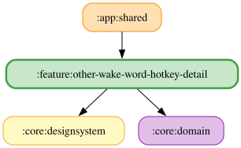

# other-wake-word-hotkey-detail

その他タブのマイク設定「ウェイクワードホットキー」の詳細ペイン。タイトルと説明に加えて、Windows デスクトップ版では「ホットキー」カードを表示する（Android・macOS・Linux では説明のみで、`ViewModel` も作らない）。ホットキーを押してコマンドの受付を始める処理は未実装。

- 数字0–9または英字A–Zと、修飾キー（Ctrl + Alt（初期値）/ Ctrl + Shift / Alt + Shift）を組み合わせて割り当てる。キー未割り当てが OFF にあたる。
- 全シミュレーターの手動読み上げセットと同じ「修飾キー＋キー」は保存せず、使用中のシミュレーターとセットを表示する。手動読み上げ側の重複確認は `:feature:manual-readout-detail` が行う。
- 保存済みキーがある場合は登録状態を表示し、競合・失敗時は「再試行」を提供する。登録状態を表示している間は OS への登録が行われる。
- カード末尾のリンクから [SimHub手順書](https://github.com/ai-kurou/KoDriver/blob/main/docs/simhub-hotkey-setup.md) を開く。

<!-- MODULE-GRAPH-START -->
## Module Dependencies

<!-- MODULE-GRAPH-END -->
