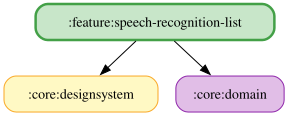

# speech-recognition-list

「音声」タブの一覧（listPane）を担う feature モジュール。選択中のシミュレーターについて、「コドライバー」と呼びかけたあとに言うと読み上げられる語句を、読み上げ項目ごとのカードで一覧にする。一覧の先頭には、呼びかけの案内（「コドライバー」を大きく見せ、確認音 → 語句を言う → 読み上げの3ステップと、長い語句を優先する旨の補足文を添える）を固定で表示する。

- 項目は `ManualReadoutItemCategory`（バーチャルエネルギー・燃料・タイヤ・ブレーキ・ラップ）ごとの見出しでまとめ、カードには手動タブと同じ種類色の帯・アイコンを付け、項目名・語句数・語句をすべて並べる（省略しない）。語句チップは種類色で薄く染める。
- 元データは `ObserveSpeechCommandGuideUseCase`（`:core:domain`）。`SpeechRecognitionListViewModel` が購読して `SpeechRecognitionListUiState` にし、`speechRecognitionListModule` で Koin に登録する。
- 読み上げのオン/オフ・検索・detailPane は対象外。

<!-- MODULE-GRAPH-START -->
## Module Dependencies

<!-- MODULE-GRAPH-END -->
