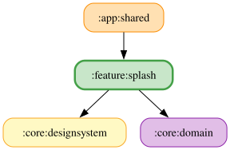

# splash

スプラッシュ画面を担うモジュール。パッケージで共通部分とデスクトップ専用部分に分けている。

## 共通（`kurou.kodriver.feature.splash`）

Android とデスクトップで同じ演出にするための部品。

- `SplashBackdrop` … 自己ベストラップの背景画像（`ReadoutBackground.BEST_LAP`）を右側に置いて左へ溶かし、その上に光の帯を重ねる背景。光の位置は `shineProgress`（0〜1）で渡す。`backgroundAlpha` を 1 未満にすると、下地と写真だけをまとめて透けさせる（デスクトップのみ使用）。
- `SplashAppIcon` … アプリアイコン。
- `SplashVersionLabel` … アプリのバージョン（`v5.3.0` 形式）。デスクトップはフェーズ名の下、Android は画面下部中央に表示する。バージョン文字列は `:app:desktopApp` の `APP_VERSION`・`:app:androidApp` の `BuildConfig.VERSION_NAME` を各ホストの `appVersion` 引数で渡す。

## Android 専用（`kurou.kodriver.feature.splash.android`）

OS のスプラッシュ（`installSplashScreen`）が終わった直後に、メイン画面の上へ約1秒だけ重ねる演出。

- `AndroidSplashOverlay` … `SplashBackdrop` とアイコンを重ね、光が横切ったあとフェードアウトして `onFinished` を一度通知する。表示中はタッチを消費し、背後のメイン画面を操作させない。縦横は `BoxWithConstraints` の描画領域で決め、縦長のときは写真を下端に置く。
- `shouldShowAndroidSplashOverlay` … 表示の可否。コールドスタート（保存状態からの復元でなく、このプロセスで未表示）で、端末のアニメーション縮尺（`ANIMATOR_DURATION_SCALE`）が 0 でないときだけ表示する。

`:app:shared` の `AndroidSplashHost` が表示の可否を判断し、`MainActivity` が判定に使う値を渡す。演出は OS のスプラッシュが外れたことを `MainActivity` が伝えてから始める（メイン画面の初回描画後も OS のスプラッシュはしばらく残るため）。通知が届かないときは一定時間後に始める。オーバーレイはアプリのテーマ（ダークテーマ・動的カラー）に合わせるため、`AppScreen` の `overlayContent` として渡す。

## デスクトップ専用（`kurou.kodriver.feature.splash.desktop`）

JVM の起動から Compose 初期化・Koin モジュール構築・Ktor サーバー起動までには数秒かかるため、その間の初期化フェーズ（[DesktopSplashStep]）を保持・購読するためのプラットフォーム非依存のコアを提供する。

- `DesktopSplashStep` … 初期化フェーズの定義と表示名。
- `DesktopSplashUiState` … スプラッシュ画面の表示状態（現在フェーズ・進捗率）。
- `DesktopSplashProgress` … 起動処理から駆動される進捗状態ホルダー。
- `runInitialization` … 進捗を更新しながら初期化処理を順に実行する `DesktopSplashProgress` 拡張関数。
- `DesktopSplashScreen` … `SplashBackdrop` の上に、アプリアイコン・進捗バー・フェーズ名を左側に表示する Composable。枠なしの透過ウィンドウに表示する前提で、角丸にして背景だけを少し透けさせる。起動完了（`READY`）で光が画面を横切り、終わると `onReadyAnimationFinished` を一度通知する。
- `DesktopSplashErrorDialog` … 初期化に失敗したことを通知するダイアログ。
- `DesktopSplashServerErrorDialog` … サーバーの起動に失敗したことを通知するダイアログ。

進捗ホルダーは Koin 起動前に生成する必要があるため、DI モジュールは提供せず、`:app:shared` の `DesktopSplashHost` から `DesktopSplashProgress` を直接生成して駆動する。`:app:desktopApp` の `main.kt` は枠なし・透過のスプラッシュ専用ウィンドウ（720×405dp、画面中央）を開き、`DesktopSplashHost` に Koin 構築・サーバー起動処理を渡して配線する。

`DesktopSplashHost` は初期化完了後、この通知を受けてから `onFinished` を通知する。`main.kt` はそれとメインウィンドウの位置・サイズの復元がそろってから、スプラッシュのウィンドウを閉じてメインウィンドウと（設定がオンなら）オーバーレイを開く。

サーバー起動の失敗（ポート8080が使用中など）では起動を止めない。`DesktopSplashHost` は `onServerStartError` を通知して `DesktopSplashServerErrorDialog` を表示し、閉じた後に初期化を続ける。`main.kt` は例外を Sentry へ送信する。

サーバー起動以外の初期化処理が例外をスローした場合、スプラッシュ画面が完了しないまま停止するのを避けるため、`DesktopSplashHost` は `DesktopSplashErrorDialog` を表示する。ダイアログを閉じると `onError` が通知され、`main.kt` は Sentry へ送信のうえアプリを終了する。

<!-- MODULE-GRAPH-START -->
## Module Dependencies

<!-- MODULE-GRAPH-END -->
